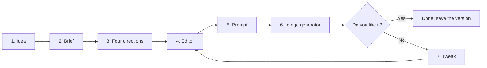
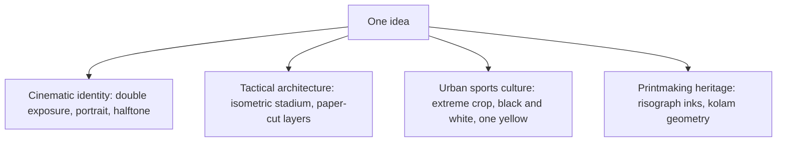
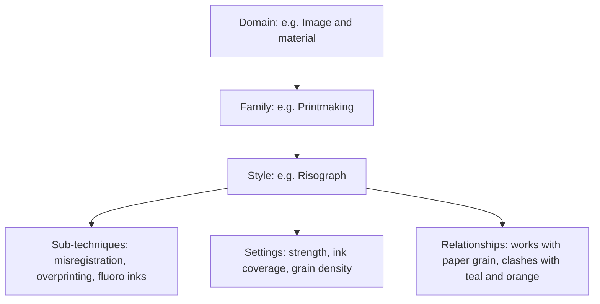
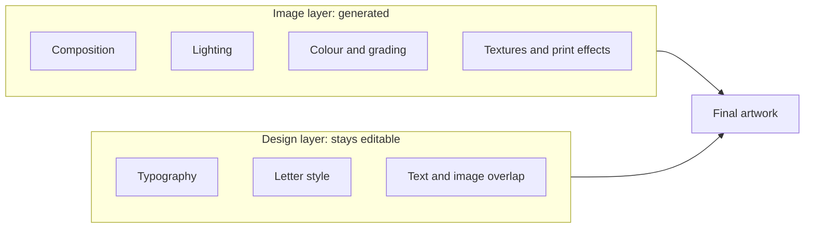
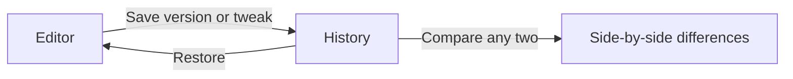

# How Visual Direction Studio works

This page explains, in plain steps and diagrams, how the studio turns an idea into an art-directed image.

---

## The big picture

You give an idea. The studio suggests ways to show it. You choose and adjust. It writes the prompt. You make the image, and if you don't like it, you tweak and try again.

---

## Step by step

### Step 1: Write your idea
Type what the image should say and who it is for.
*Example: "A CSK tribute about Chennai, its people and the team. Premium, emotional, culturally grounded."*

### Step 2: Check the brief
The studio pulls out the key points:

| Field | Example |
| --- | --- |
| Subject | Chennai Super Kings |
| Core message | Collective identity |
| Emotion | Pride + belonging |
| Visual character | Premium + editorial |
| Format | 16:9 |
| Don't repeat | Lion mascot, flag waving |

You can change any of these. The **Don't repeat** box stops the studio from suggesting clichés you've already seen.

### Step 3: Get four directions
The studio proposes four different ways to show the same idea. Each one is a **combination of techniques** from the library, with a short reason why it fits.

Same message, four visual languages. Pick the one closest to what you want.

### Step 4: Adjust it in the editor
Every technique is one row. For each row you can:

| Action | What it does |
| --- | --- |
| 🔒 Lock | Keep it. Nothing will change it. |
| Swap | Choose a different style in the same family. |
| Sub-techniques | Turn individual details on or off. |
| Strength slider | Move from subtle to dominant. |
| 🎲 Randomise | Try a different style that still fits the locked ones. |
| ✕ Remove | Take it out. |
| Undo / Save version | Step back, or keep a snapshot. |

A **coherence score** tells you how well the pieces work together:
- **+** they support each other
- **~** they create useful tension
- **×** they fight each other

### Step 5: Copy the prompt
The studio turns your choices into a ready-made prompt for any image generator. Typography is kept out of the image on purpose, so you can add text later as an editable layer.

### Step 6: Make the image
Paste the prompt into the image generator you use.

### Step 7: Don't like it? Tweak it
Write what to change, for example:
*"Keep the composition and colours. Replace double exposure with silhouette fill. Reduce paper grain."*

The studio changes **only** those rows, never touches locked ones, and saves the result as a new version. Then go back to Step 5.

---

## How the technique library is organised

Each idea is built from small, reusable pieces arranged in levels.

| Level | Count |
| --- | --- |
| Families | 22 |
| Styles | 199 |
| Sub-techniques | 714 |
| Relationships between styles | 76 |

The six domains are **Composition and space**, **Colour**, **Light and atmosphere**, **Image and material**, **Typography** and **Meaning and culture**.

---

## Image layer vs design layer

Not everything should be generated by the AI.

Changing a title's font or position shouldn't require making the whole picture again.

---

## Where your work is saved

History is stored in your own browser only. Clearing browser data, or switching to another device or browser, starts it fresh.

---

## With or without Claude

| Feature | Without Claude | With Claude (opened on claude.ai) |
| --- | --- | --- |
| Suggest directions | Built-in rules match keywords to recipes | Claude reads the idea and builds four new directions |
| Tweak | Understands plain commands like "remove halftone" | Understands any feedback, and can compare an uploaded image |
| Ask why | Library shows pairings and conflicts | Claude answers questions like "what if I swap X for Y?" |
| Learn a technique | Library entry | Claude writes a short lesson |

---

## What it does not do yet

- It does not create the final image. You paste the prompt into your own image generator.
- The sketches are rough layout diagrams, not previews of the final art.
- Projects are not shared between people or devices yet.
